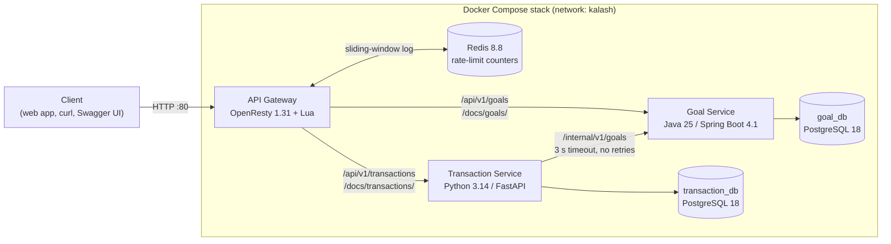

# Kalash - Savings Goal Planner

Kalash helps a customer save for goals such as a trip or a new phone. They
set a target amount and date, record deposits and withdrawals, and see their
progress, a suggested monthly saving, and whether they are off track or
overdue. This repository is the Release 1 backend: two microservices behind
an API gateway, built to run locally with Docker.

**Status: Release 1 implementation complete (plan phases P0 to P9).** All 16
user stories are implemented and unit tested. The CI/CD workflows are in
place, and pushing and deploying wait on the open hosting and registry
decisions. See the [changelog](CHANGELOG.md).

## 1. Overview

### Release 1 scope

- **Goal Service:** creates, edits and cancels goals, keeps each goal's
  balance and status, and computes savings insights.
- **Transaction Service:** records deposits and withdrawals, edits and
  deletes them, keeps transaction history, and coordinates deleting a
  cancelled goal.
- **API Gateway:** one public origin with routing, a Redis-backed per-IP rate
  limit, documentation routes and a landing page.

Each service owns its PostgreSQL database. The Transaction Service calls the
Goal Service; the Goal Service never calls back.

Not in Release 1:
- the React web app;
- the authentication and profile service;
- back-end authentication of any kind;
- integration and end-to-end test suites.

See [Security notes](#16-security-notes-and-release-1-limitations).

### Architecture



A deposit, withdrawal, edit or deletion is a cross-service write:
1. The Transaction Service writes its own change but does not commit it.
2. It asks the Goal Service to adjust the balance.
3. It commits only if the Goal Service accepts.
4. On any rejection, timeout or error it rolls back.

The two databases are not updated atomically. If the local commit fails
after the Goal Service has already applied the change, the mismatch is
logged for manual correction
([triage](TROUBLESHOOTING.md#cross-service-mismatch-or-unknown-outcome)).

## 2. Repository structure

| Location | Purpose |
|---|---|
| [services/goal-service](services/goal-service/README.md) | Goal Service: goals, balances, status and insights |
| [services/transaction-service](services/transaction-service/README.md) | Transaction Service: transactions, history, goal deletion |
| [gateway](gateway/README.md) | OpenResty/Lua API Gateway and Redis rate limiter |
| [scripts](scripts/README.md) | Paired Bash (`.sh`) and PowerShell (`.ps1`) automation |
| [docs](docs/) | BRD, HLD, LLD, implementation plan, LLD 1.1 updates, UI designs |
| [docs/adr](docs/adr/README.md) | Architecture decision records |
| [tests/integration](tests/integration/README.md), [tests/e2e](tests/e2e/README.md) | Placeholders for later suites |
| [.github](.github/) | CI/CD workflows, pull request and issue templates |
| [docker-compose.yml](docker-compose.yml) | Full stack: gateway, both services, both databases, Redis |
| [Makefile](Makefile) | Root targets (`make help`) |

Every project builds, tests and runs on its own. Each has its own README,
Makefile, Dockerfile, `.dockerignore`, `docker-compose.yml` and
`.env.example`. The root holds only documentation, orchestration and
repository configuration. Unit tests mirror the package structure of the
code they test.

## 3. Technology stack

| Component | Versions |
|---|---|
| Goal Service | Java 25, Spring Boot 4.1.2, Spring Data JPA, Flyway, springdoc 3.2.0, Maven Wrapper (Maven 3.9.11) |
| Transaction Service | Python 3.14, FastAPI 0.136.3, Pydantic 2, SQLAlchemy 2, Alembic, psycopg 3, httpx, uv 0.9 |
| Gateway | OpenResty 1.31.1.1 (Nginx with LuaJIT), lua-resty-redis |
| Data | PostgreSQL 18.6 (one database per service), Redis 8.8.4 |
| Quality | JUnit Jupiter 6.0.3, Mockito, AssertJ, JaCoCo, Spotless; pytest, respx, pytest-cov, Ruff; busted, luacheck, luacov |
| Runtime images | `eclipse-temurin:25.0.4.1_1-jre`, `python:3.14.10-slim`, `openresty/openresty:1.31.1.1-alpine`, `postgres:18.6`, `redis:8.8.4-alpine` |
| Tooling | Docker Engine 29 with Compose v2, GNU Make 4, Bash, PowerShell 7 or 5.1, GitHub Actions |

## 4. Prerequisites

| Tool | Needed for | Windows | macOS | Linux |
|---|---|---|---|---|
| Docker with Compose v2 | Everything | Docker Desktop | Docker Desktop | Docker Engine and the Compose plugin |
| GNU Make | `make` targets | `choco install make` or `winget install GnuWin32.Make` | Xcode Command Line Tools | `make` package |
| PowerShell 7 | `.ps1` scripts on Windows | `winget install Microsoft.PowerShell` (or `POWERSHELL=powershell` for 5.1) | Not needed | Not needed |
| uv 0.9 or newer | Transaction Service lint, tests and host runs | `winget install astral-sh.uv` | `brew install uv` | [installer](https://docs.astral.sh/uv/getting-started/installation/) |
| Java 25 | Optional: Goal Service on the host | Temurin 25 | Temurin 25 | Temurin 25 |
| Git, curl | Clone; Bash `wait-for-ready` | Git for Windows | Built in | Packages |

Without Java 25, the Goal targets run Maven in a Java 25 container
automatically, so the host JDK can stay as it is. `make setup` checks all of
these and says what is missing. Make on Windows runs the `.ps1` scripts;
from Git Bash, add `SCRIPT_SHELL=sh` to use the `.sh` versions. See
[GNU Make on Windows](TROUBLESHOOTING.md#gnu-make-on-windows).

## 5. Quick start: full stack in Docker

```powershell
git clone https://github.com/iomegak12/fmr-ai-usecase-1.git kalash
cd kalash
make setup    # check tools; create missing .env files with generated passwords
make up       # build, start, wait until all six containers are healthy and ready
```

`make setup` creates each missing `.env` from its `.env.example`, fills the
blank database passwords with random development values without printing
them, and never changes an existing `.env`. The first `make up` builds three
images, which takes a few minutes and needs network access. Later runs reuse
them, and `make up` on unchanged sources leaves a running stack untouched.

| URL | What |
|---|---|
| <http://localhost/> | Landing page with every link below |
| <http://localhost/docs/goals/> | Goal Service Swagger UI |
| <http://localhost/docs/transactions/> | Transaction Service Swagger UI |
| <http://localhost/api/v1/goals> | Goal API (rate limited) |
| <http://localhost/api/v1/transactions?goalId=...> | Transaction API (rate limited) |
| <http://localhost/health>, <http://localhost/ready> | Gateway liveness and readiness |

Try it:

```bash
curl -s -X POST localhost/api/v1/goals -H 'Content-Type: application/json' \
  -d '{"name":"Goa Trip","targetAmount":50000,"targetDate":"2027-03-31"}'
curl -s -X POST localhost/api/v1/transactions -H 'Content-Type: application/json' \
  -d '{"goalId":"<goalId from the first response>","type":"DEPOSIT","amount":5000}'
```

`make ps` shows status and health, `make logs` follows the logs, and
`make down` stops the stack and keeps its data. To delete the data as well,
run `docker compose down -v`.

### Running the services on the host

1. `make setup`, then start the databases. For example, run `make up`, then
   `docker compose stop goal-service transaction-service` to free ports 8080
   and 8000.
2. `make migrate` applies the Transaction Service's Alembic migrations. The
   Goal Service runs its Flyway migration at start-up.
3. In two terminals, run `make run-goal` and `make run-txn`. Both run in the
   foreground with the `local` profile and coloured logs; Ctrl+C stops them.

`make run-goal` loads `services/goal-service/.env` into the process
environment, because Spring does not read `.env`. The Transaction Service
reads its own `.env`. Behind the gateway, the Transaction Service needs
`APP_ROOT_PATH=/docs/transactions` for its documentation route.

## 6. Configuration

Configuration comes from environment variables, set through `.env` files that
are never committed. The root [.env.example](.env.example) serves the full
stack. Each project's `.env.example` serves host runs and that project's own
compose file. The root compose file fixes the values that wire the stack
together: profiles, container ports, database hosts and `APP_ROOT_PATH`. It
passes each container only the variables that container needs, so database
passwords never reach the other service or the gateway.

| Variable | Used by | Default |
|---|---|---|
| `APP_ENV` / `SPRING_PROFILES_ACTIVE` | Transaction / Goal profile: coloured console in `local`, JSON logs in `docker` | `local` (`docker` in Compose) |
| `APP_TIMEZONE` | Both services: business "today" | `Asia/Kolkata` |
| `LOG_LEVEL` | Both services | `INFO` |
| `NO_COLOR` | Any value turns off console colours | unset |
| `GOAL_SERVICE_PORT` / `TXN_SERVICE_PORT` | Service listening ports | `8080` / `8000` |
| `GOAL_DB_HOST` / `_PORT` / `_NAME` / `_USER` / `_PASSWORD` | Goal Service and goal-db | `goal-db` / `5432` / `goal_db` / `goal_user` / required |
| `TXN_DB_HOST` / `_PORT` / `_NAME` / `_USER` / `_PASSWORD` | Transaction Service and transaction-db | `transaction-db` / `5432` / `transaction_db` / `txn_user` / required |
| `GOAL_SERVICE_BASE_URL` | Transaction Service's Goal client | `http://goal-service:8080` |
| `GOAL_SERVICE_TIMEOUT_SECONDS` | Goal client timeout, no retries | `3` |
| `APP_ROOT_PATH` | Transaction documentation prefix | empty; `/docs/transactions` behind the gateway |
| `REDIS_HOST` / `REDIS_PORT` / `REDIS_TIMEOUT_MS` | Gateway | `redis` / `6379` / `100` |
| `RATE_LIMIT_REQUESTS` / `RATE_LIMIT_WINDOW_SECONDS` / `RATE_LIMIT_WARMUP_SECONDS` | Gateway | `100` / `60` / `30` |
| `TRUSTED_PROXIES` | Gateway: proxies allowed to set `X-Forwarded-For` | empty |
| `GOAL_SERVICE_UPSTREAM` / `TXN_SERVICE_UPSTREAM` | Gateway upstreams | `goal-service:8080` / `transaction-service:8000` |
| `GATEWAY_RESOLVER` | Gateway DNS resolver | the container's first nameserver |
| `CONTAINER_GOAL_SERVICE_BASE_URL` / `CONTAINER_APP_ROOT_PATH` | Transaction project compose file | `http://host.docker.internal:8080` / empty |
| `KALASH_IMAGE_PREFIX` / `KALASH_IMAGE_TAG` | Root compose image names (deployments) | `kalash` / `0.1.0` |
| `GIT_SHA` / `BUILD_DATE` | Image labels, set by Make and CI | HEAD short SHA / HEAD commit time |
| `BACKUP_DIR` / `BACKUP_RETENTION_DAYS` | Backup scripts | `./backups` / `7` |
| `GOAL_RUNNER` | Goal scripts: `auto`, `host` or `docker` | `auto` |
| `MAVEN_IMAGE` / `GOAL_MAVEN_CACHE` / `GATEWAY_TEST_IMAGE` | Scripts that use containers | `maven:3.9.11-eclipse-temurin-25` / `kalash-goal-maven-cache` / `kalash/gateway-test` |
| `SCRIPT_SHELL` / `POWERSHELL` | Makefiles | `ps1` on Windows, else `sh` / `pwsh` |

Host runs use the `local` profile, `localhost` database hosts and the
published ports. The Transaction database's host port is `5433`. Settings
are validated at start-up, and an invalid value stops the process with a
message naming the variable. Passwords appear only in `.env`, never in code,
logs or the start-up banner. The authoritative matrix is
[plan Section 6](docs/Kalash_Project_Impl_Plan_Opus_v1.0.md#6-configuration-matrix).

## 7. Services

| Component | Host port | API base path | Swagger / OpenAPI | Liveness | Readiness |
|---|---|---|---|---|---|
| Gateway | 80 | `/api/v1/goals`, `/api/v1/transactions` | `/docs/goals/`, `/docs/transactions/` | `/health` | `/ready` (Redis; `DEGRADED` with HTTP 200 when it is down) |
| Goal Service | 8080 | `/api/v1/goals` | `/swagger-ui`, `/v3/api-docs` | `/health` | `/ready` (`goal_db`) |
| Transaction Service | 8000 | `/api/v1/transactions` | `/docs`, `/openapi.json` | `/health` | `/ready` (`transaction_db`) |
| goal-db | 5432 | - | - | - | `pg_isready` |
| transaction-db | 5433 | - | - | - | `pg_isready` |
| redis | not published | - | - | - | `redis-cli ping` |

Readiness checks only a service's own database; liveness checks nothing
external, so a database outage never restarts a service (ADR-0008).
The gateway passes `/health/goals`, `/ready/goals`, `/health/transactions`
and `/ready/transactions` through to the services.

Metrics (`/actuator/prometheus`, `/metrics`) and the Goal Service's
`/internal/v1/*` operations are available only on the direct ports; the
gateway answers 404 for them. No endpoint sends CORS headers.

## 8. API summary

All requests and responses are JSON. Amounts are whole rupees (integers),
dates are ISO `YYYY-MM-DD`, and timestamps are UTC.

| Method | Path | Result |
|---|---|---|
| POST | `/api/v1/goals` | 201 goal, with `Location` |
| GET | `/api/v1/goals?page=0&size=20` | 200 page of goals with insights, nearest target date first |
| GET | `/api/v1/goals/{goalId}` | 200 goal with insights (progress, remaining, suggested monthly saving, off-track, overdue) |
| PATCH | `/api/v1/goals/{goalId}` | 200 goal; any of `name`, `targetAmount`, `targetDate` |
| POST | `/api/v1/goals/{goalId}/cancel` | 200 cancelled goal |
| POST | `/api/v1/transactions` | 201 transaction: `{"goalId", "type": "DEPOSIT" or "WITHDRAWAL", "amount"}` |
| GET | `/api/v1/transactions?goalId={id}&page=0&size=20` | 200 history, newest first |
| PATCH | `/api/v1/transactions/{transactionId}` | 200 transaction: `{"amount"}` only |
| DELETE | `/api/v1/transactions/{transactionId}` | 204 |
| DELETE | `/api/v1/transactions/goals/{goalId}` | 204: deletes a cancelled goal and its history |

Page size is 1 to 100 (default 20). Full contracts, examples and rules are in
each Swagger UI and the
[Goal](services/goal-service/README.md#goal-and-balance-apis) and
[Transaction](services/transaction-service/README.md#business-apis) READMEs.

### Errors

Every error is RFC 9457 Problem Details (`application/problem+json`) with
`type`, `title`, `status`, `detail`, `instance`, `errorCode`,
`correlationId`, `timestamp` and, for validation, `errors[]`. Goal Service
errors pass through the Transaction Service unchanged.

| Code | HTTP | Meaning |
|---|---|---|
| `COMMON-400` | 400 | Validation failed |
| `COMMON-409` | 409 | Concurrent update conflict, please retry |
| `COMMON-429` | 429 | Too many requests (gateway rate limit) |
| `COMMON-500` | 500 | Unexpected error |
| `GOAL-001` | 404 | Goal not found |
| `GOAL-002` | 409 | Goal name already in use |
| `GOAL-003` to `GOAL-005` | 422 | Target date not in the future; target not above the balance; change not permitted for the status |
| `GOAL-006` to `GOAL-008` | 422 | Only Active goals can be cancelled; withdraw the full balance first; only Cancelled goals can be deleted |
| `GOAL-009` to `GOAL-012` | 422 | Deposit needs an Active goal; no withdrawals on Cancelled goals; transactions change only on Active goals; balance cannot go below 0 |
| `TXN-001` | 404 | Transaction not found |
| `TXN-002` | 503 | Goal Service unavailable |
| `TXN-003` | 504 | Goal Service did not respond in time |

The full catalogue is
[LLD Section 21.2](docs/Kalash_LLD_v1.0.md#212-error-code-catalogue), plus
`COMMON-429` ([ADR-0007](docs/adr/0007-429-problem-details.md)).
Fixes for common rejections are in [Troubleshooting](TROUBLESHOOTING.md).

## 9. Rate limiting

The gateway limits each client IP to **100 requests in any rolling 60
seconds** on `/api/v1/*` (ADR-0002 to ADR-0007):

- **Counting:** a sliding-window log in Redis, updated by one atomic Lua
  script, so concurrent requests cannot overshoot.
- **Warm-up:** for 30 seconds after the gateway starts, requests are neither
  limited nor counted.
- **Rejection:** HTTP 429 with `COMMON-429` Problem Details and
  `Retry-After`. Every counted response carries `X-RateLimit-Limit`,
  `X-RateLimit-Remaining` and `X-RateLimit-Reset` (seconds until capacity
  returns).
- **Redis down:** the gateway fails open. Requests are forwarded and each
  is logged at ERROR (`event=ratelimit_store_unavailable`), and `/ready`
  reports `DEGRADED`.
- **Exempt:** health, readiness, documentation and the landing page are
  never limited.
- **Client identity:** `$remote_addr`. `X-Forwarded-For` is trusted only
  from `TRUSTED_PROXIES`.

## 10. Logging, correlation, start-up and shutdown

- **Logs.**
  - In Docker, each component logs one JSON object per line: ECS for the
    Goal Service, JSON for the Transaction Service, and a JSON access log
    with the rate-limit outcome for the gateway.
  - Host runs (`local` profile) log coloured, human-readable lines.
  - Logs never contain passwords, request bodies or raw exception text.
- **Correlation IDs.**
  - The gateway reuses a client's `X-Correlation-ID` if it matches
    `^[A-Za-z0-9._-]{1,128}$`, and otherwise creates one.
  - The ID is passed to each service and from the Transaction Service to
    the Goal Service, appears in every log line and error body, and is
    returned on every response.
- **Start-up banner.** Each component prints a summary: name, version,
  profile, URLs, database or upstream addresses and limiter settings. It is
  coloured only on a terminal with `NO_COLOR` unset, and never includes
  secrets.
- **Shutdown.** Ctrl+C or SIGTERM stops each process immediately and logs
  its pools and clients closing (ADR-0010). `docker compose down` takes
  about 2 seconds. The Goal JVM's exit code 143 is normal after SIGTERM.

## 11. Testing

| Project | Framework | Coverage gate | Latest result |
|---|---|---|---|
| Goal Service | JUnit Jupiter, Mockito, AssertJ, MockMvc slices | JaCoCo, 80% lines | 177 tests, 98.43% |
| Transaction Service | pytest, FastAPI TestClient, respx | pytest-cov, 80% lines | 187 tests, 99.85% |
| Gateway | busted with fake `ngx` and Redis doubles | luacov report, no gate | 80 tests, 99.65% |

```bash
make test        # unit tests, all projects (or test-goal, test-txn, test-gateway)
make coverage    # with coverage reports and the 80% gates
make lint        # Spotless check, Ruff check and format check, luacheck
```

- Unit tests start no database, Redis or network service, and use fixed
  clocks.
- Every business rule BR-01 to BR-25 and every error code has tests; see
  the [traceability matrix](docs/Kalash_Project_Impl_Plan_Opus_v1.0.md#8-traceability-matrix).
- Coverage reports:
  - Goal: `services/goal-service/target/site/jacoco/index.html`
  - Transaction: `services/transaction-service/htmlcov/index.html`
  - Gateway: `gateway/luacov.report.out`
- Integration and end-to-end suites are out of scope for Release 1. Their
  folders, [tests/integration](tests/integration/README.md) and
  [tests/e2e](tests/e2e/README.md), are placeholders.

## 12. Make targets and scripts

| Target | What it does |
|---|---|
| `make setup` | Checks tools, creates missing `.env` files, installs Transaction dependencies |
| `make format` / `make lint` | Spotless and Ruff formatting / Spotless check, Ruff check and format check, luacheck |
| `make test` / `test-goal` / `test-txn` / `test-gateway` | Unit tests |
| `make coverage` | Unit tests with coverage reports and gates |
| `make build` / `up` / `down` / `restart` / `ps` / `logs` | Full-stack Compose lifecycle |
| `make run-goal` / `make run-txn` | Run one service on the host |
| `make migrate` | Transaction Service migrations |
| `make backup` / `make restore DB=... FILE=...` | Database backup and restore |
| `make clean` | Remove build output, caches and coverage reports |

Each target runs a script from [scripts/](scripts/README.md): `.ps1` on
Windows and `.sh` elsewhere, with identical behaviour. Each project directory
has its own Makefile with that project's targets. Without Make, run a script
directly, for example `bash scripts/test.sh txn` or
`pwsh scripts/test.ps1 txn`.

## 13. Docker and Compose

- **Root stack** ([docker-compose.yml](docker-compose.yml)):
  - Six containers on one network, started in readiness order.
  - Health checks and `restart: unless-stopped` on every container.
  - Named volumes `kalash_goal-data` and `kalash_transaction-data`.
  - Log rotation (10 MB x 3) and short stop grace periods.
  - Redis is not published and keeps no data.
- **Project stacks** (each project's `docker-compose.yml`):
  - Goal Service with goal-db; Transaction Service with transaction-db; the
    gateway with Redis.
  - They reach each other through `host.docker.internal`. On Linux, set the
    gateway's upstreams to the host's bridge address (see the
    [gateway guide](gateway/README.md)).
- **Images:**
  - Multi-stage builds on pinned bases.
  - Every image runs as the non-root user `kalash` (uid 10001).
  - OCI labels record the version, git SHA, MIT licence and commit time.
  - The Transaction image applies its migrations before starting.

## 14. CI/CD

GitHub Actions workflows in [.github/workflows](.github/workflows/):

| Workflow | Runs on | Steps |
|---|---|---|
| `goal-service.yml` | Goal changes, `main`, `v*` tags, PRs | Java 25, native-SQL search, Spotless check, tests with the JaCoCo gate, coverage upload, image build and non-root check, push |
| `transaction-service.yml` | Transaction changes, `main`, `v*` tags, PRs | uv, raw-SQL search, Ruff, tests with the pytest-cov gate, coverage upload, image build and non-root check, push |
| `gateway.yml` | Gateway changes, `main`, `v*` tags, PRs | luacheck, busted with luacov, image build, `nginx -t` in the image, push |
| `image.yml` | Called by the three above | Shared build, check and push job |
| `deploy.yml` | Manual, or a published release | Waits for the images, then runs `docker compose pull` and `up -d` on the target host over SSH |

- **Pull requests.** All three pipelines run on every pull request, and a
  project the PR does not touch reports as skipped (passing). Make all
  three required in branch protection (see
  [CONTRIBUTING](CONTRIBUTING.md#tests-and-quality-gates)).
- **Image tags.** Every image is tagged with the 7-character git SHA. A
  `vX.Y.Z` tag also adds `X.Y.Z`, and the tag must equal each project's own
  version.
- **Pushing.** Images are pushed only from `main` and release tags.
- **Not yet configured.**
  - Pushing waits on the repository variable `KALASH_REGISTRY` and the
    secrets `REGISTRY_USERNAME` and `REGISTRY_PASSWORD`; until then images
    are built and checked only.
  - Deployment also needs `DEPLOY_HOST`, `DEPLOY_USER`, `DEPLOY_PATH`,
    `DEPLOY_SSH_KEY`, `DEPLOY_KNOWN_HOSTS` and a `production` environment;
    until then it skips with a notice.
  - Both wait on plan Open Issues 1 and 2.

## 15. Backup and restore

```bash
make backup                                           # both databases
make restore DB=goal_db FILE=backups/goal_db/2026-10-28.dump
```

`make backup` dumps each database of the running root stack (`pg_dump -Fc`)
to `BACKUP_DIR/<db>/<YYYY-MM-DD>.dump`. It checks each dump and deletes dated
dumps older than `BACKUP_RETENTION_DAYS` (7).

`make restore`:
- refuses a file that is not a backup of that database;
- stops the owning service while it runs;
- restores in a single transaction, so a failure changes nothing;
- always starts the service again.

Restore both databases from the same day to keep balances and history
consistent. Scheduling, for example daily at 02:00 IST with cron or Task
Scheduler, is described in the [scripts guide](scripts/README.md#backups).

## 16. Security notes and Release 1 limitations

Release 1 is a **local demonstration**. Do not expose it to the internet.

- There is no authentication or authorisation on any API. Anyone who can
  reach a port can read and change data.
- Direct service ports (including `/internal/*` and metrics) and the
  database ports are published for local development only. The gateway
  blocks internal and metrics paths, but the direct ports are not
  protected.
- Rate limiting is a fairness control, not a security boundary. It pauses
  for 30 seconds after every gateway start and fails open when Redis is
  down.
- Documentation is public. A policy for non-local use is
  [plan Open Issue 10](docs/Kalash_Project_Impl_Plan_Opus_v1.0.md#10-open-issues).
- Cross-service writes are not atomic; mismatches are logged for manual
  correction.
- Use synthetic data only. Keep `.env` files and backups private.

Report vulnerabilities privately as described in the
[security policy](SECURITY.md).

## 17. Documentation and governance

| Document | Purpose |
|---|---|
| [Business requirements (BRD) v1.0](docs/Kalash_BRD_v1.0.md) | User stories KAL-BUC-00001 to 00016 and rules BR-01 to BR-25 |
| [High-level design v1.1](docs/Kalash_HLD_v1.1.md) | Architecture |
| [Low-level design v1.0](docs/Kalash_LLD_v1.0.md) | Contracts, schemas, error catalogue, calculations |
| [LLD 1.1 update list](docs/Kalash_LLD_v1.1_Updates.md) | Changes the LLD needs to match Release 1 |
| [Implementation plan](docs/Kalash_Project_Impl_Plan_Opus_v1.0.md) | Decisions, phases, evidence, traceability, Definition of Done |
| [Architecture decision records](docs/adr/README.md) | Why the major deviations were made |
| [UI designs](docs/ui-design/) | Web app mock-ups (the web app is outside Release 1) |
| [Archived plan](archives/Kalash_Project_Impl_Plan_v1.0.md) | Alternative plan, kept for reference |

- [Contributing](CONTRIBUTING.md) and the [Code of Conduct](CODE_OF_CONDUCT.md)
  (Contributor Covenant 2.1)
- [Security policy](SECURITY.md)
- [Troubleshooting](TROUBLESHOOTING.md)
- [Changelog](CHANGELOG.md)
- [License](LICENSE): MIT, Copyright (c) 2026 Kalash Financial Services
- Templates: [pull request](.github/PULL_REQUEST_TEMPLATE.md),
  [bug report](.github/ISSUE_TEMPLATE/bug_report.md),
  [feature request](.github/ISSUE_TEMPLATE/feature_request.md)
