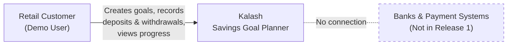
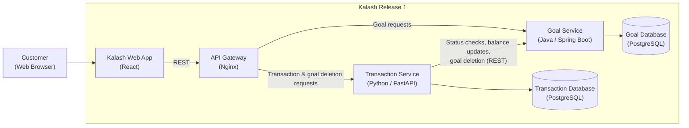
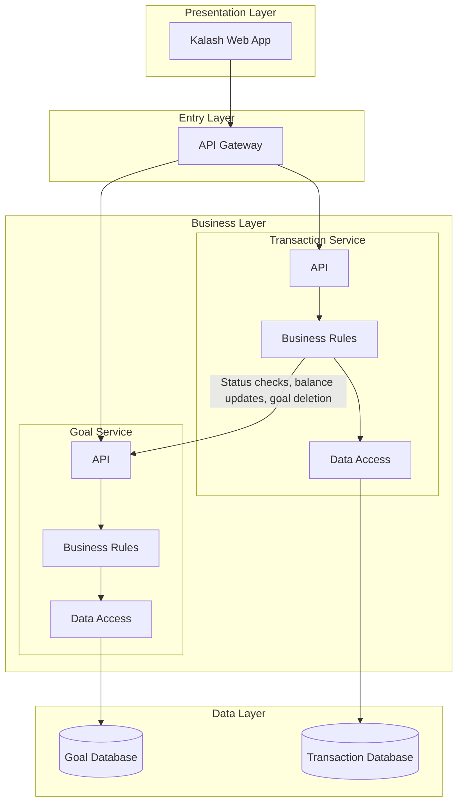
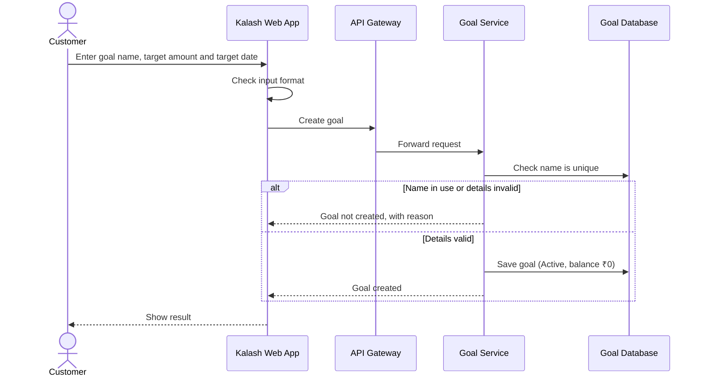
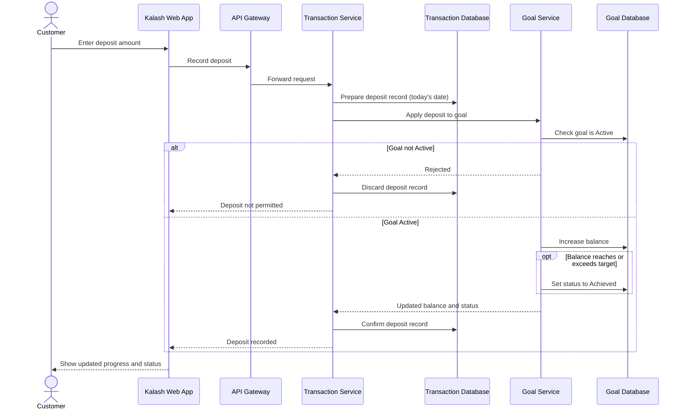
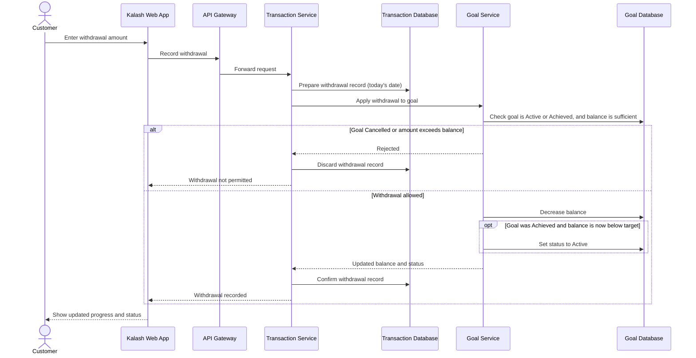
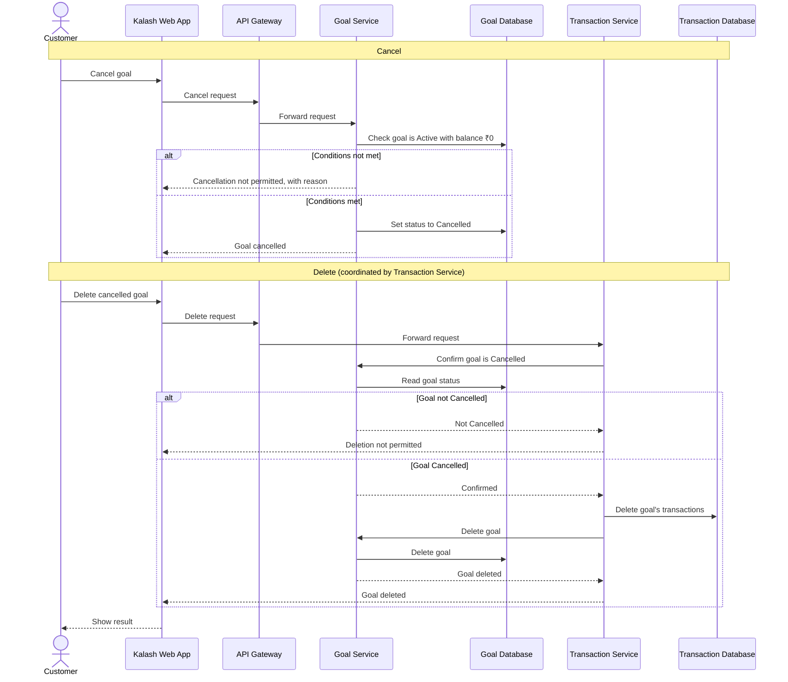
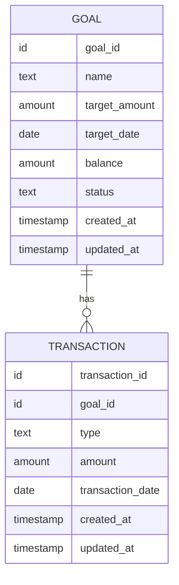
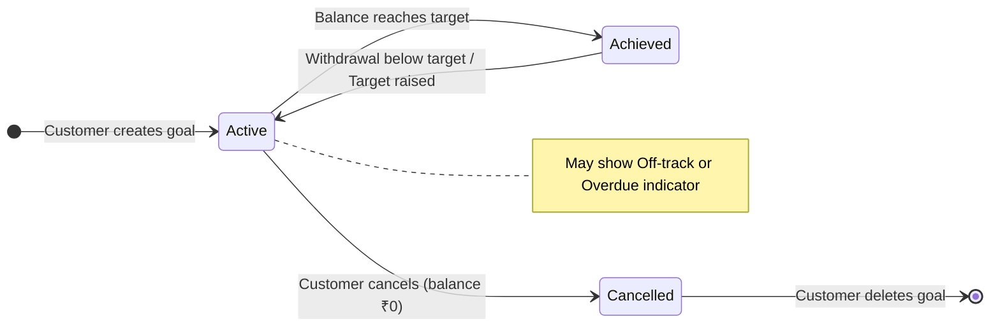
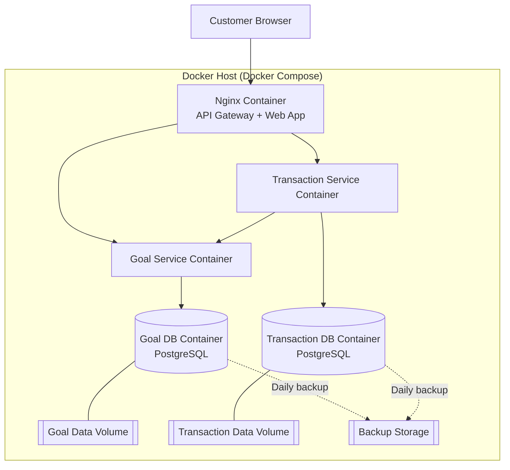

# High Level Design Document
## Kalash – Savings Goal Planner (Release 1)

---

## 1. Document Control

| Item | Details |
|---|---|
| Document Title | High Level Design – Kalash Savings Goal Planner |
| Product | Kalash |
| Release | Release 1 |
| Prepared By | Kalash Financial Services |
| Prepared For | [Client Name] |
| Version | 1.1 – Draft for Review |
| Date | 27 October 2026 |
| Status | Draft for Review |

### 1.1 Revision History

| Version | Date | Summary of Changes |
|---|---|---|
| 1.0 | 27 October 2026 | Initial draft |
| 1.1 | 27 October 2026 | One-way service dependency: deletion of cancelled goals is now coordinated by the Transaction Service. The Goal Service no longer calls the Transaction Service. |

---

## 2. Introduction

> **In simple terms:** This document explains how Kalash will be built, at a level that both business and technical readers can follow.

| Item | Details |
|---|---|
| Purpose | Describe the overall structure of Kalash Release 1 and how its parts work together |
| Scope | All capabilities in the Kalash Release 1 Business Requirements Document |
| Audience | Business stakeholders, product owners, architects and the delivery team |
| Detail Level | High level. Detailed design is covered in the Low Level Design (LLD) document. |

---

## 3. References

| Document | Version |
|---|---|
| Business Requirements Document – Kalash Savings Goal Planner | 1.0 – Draft for Review |

---

## 4. Requirements Traceability Summary

> **In simple terms:** Every user story in the BRD is assigned to the part of the system that delivers it.

| User Story | Title | Delivered By | Related Flow |
|---|---|---|---|
| KAL-BUC-00001 | Create a Savings Goal | Goal Service | Flow 1 |
| KAL-BUC-00002 | Edit a Savings Goal | Goal Service | – |
| KAL-BUC-00003 | Cancel a Savings Goal | Goal Service | Flow 4 |
| KAL-BUC-00004 | Delete a Cancelled Goal | Transaction Service, Goal Service | Flow 4 |
| KAL-BUC-00005 | Record a Deposit | Transaction Service, Goal Service | Flow 2 |
| KAL-BUC-00006 | Record a Withdrawal | Transaction Service, Goal Service | Flow 3 |
| KAL-BUC-00007 | Edit a Transaction | Transaction Service, Goal Service | – |
| KAL-BUC-00008 | Delete a Transaction | Transaction Service, Goal Service | – |
| KAL-BUC-00009 | View Transaction History | Transaction Service | – |
| KAL-BUC-00010 | View Goal Progress | Goal Service | – |
| KAL-BUC-00011 | View Suggested Monthly Saving | Goal Service | – |
| KAL-BUC-00012 | Identify Off-track Goals | Goal Service | – |
| KAL-BUC-00013 | Identify Overdue Goals | Goal Service | – |
| KAL-BUC-00014 | View All-Goals Overview | Goal Service | – |
| KAL-BUC-00015 | Automatic Goal Achievement | Goal Service | Flow 2 |
| KAL-BUC-00016 | Return an Achieved Goal to Active | Goal Service | Flow 3 |

All user stories are presented to the customer through the Kalash Web App.

---

## 5. Architecture Goals and Principles

> **In simple terms:** These are the guiding ideas behind every design choice.

| Principle | What It Means for Kalash |
|---|---|
| Simplicity | Only what Release 1 needs, with no unnecessary components |
| Clear Ownership | Each service owns its own data and business rules |
| Rules in One Place | Business rules are enforced by the back-end services, not just the screen |
| Accuracy First | Balances and goal statuses are always correct and consistent |
| Independent Parts | Each service can be built, deployed and scaled on its own |
| One-Way Dependencies | The Transaction Service may call the Goal Service; the Goal Service never calls the Transaction Service |
| Ready to Grow | Future capabilities can be added without redesigning the core |

---

## 6. Assumptions and Constraints

> **In simple terms:** These are the conditions the design relies on and the limits it works within.

### 6.1 Assumptions

1. Release 1 is used by a single demonstration customer.
2. Customers record their deposits and withdrawals themselves; no money moves.
3. All amounts are in whole Indian Rupees.
4. All dates follow Indian Standard Time (IST).

### 6.2 Constraints

1. PostgreSQL is the database, in line with organisational policy.
2. No authentication or authorisation in the back end for Release 1.
3. No integration with banks or any external system.
4. INR is the only currency.
5. The technology stack is fixed as described in Section 17.

---

## 7. System Context

> **In simple terms:** Kalash is a self-contained application used by the customer. It does not connect to any outside system in Release 1.

---

## 8. Architecture Overview

> **In simple terms:** The customer uses a web app. Requests pass through a single entry point to two small services, and each service keeps its own data.

| Component | Role |
|---|---|
| Kalash Web App | The screens the customer uses, on desktop or mobile browsers |
| API Gateway | The single entry point that routes each request to the right service |
| Goal Service | Manages goals, balances, statuses and insights |
| Transaction Service | Manages deposits, withdrawals and transaction history; coordinates deletion of cancelled goals |
| Goal Database | Stores goal data, owned by the Goal Service |
| Transaction Database | Stores transaction data, owned by the Transaction Service |

---

## 9. Architecture Style and Patterns

> **In simple terms:** Kalash is built from small, independent services that work together.

| Pattern | Use in Kalash |
|---|---|
| Microservices | Two services: Goal Service and Transaction Service |
| Database per Service | Each service has its own PostgreSQL database |
| API Gateway | Nginx provides one entry point for the web app |
| Synchronous REST | Services communicate through direct request-and-response calls |
| Layered Service Design | Each service is organised into API, business rules and data access layers |
| Stateless Services | Services hold no session data, so they are easy to restart and scale |
| Containerisation | Every component runs in its own Docker container |

---

## 10. Logical Architecture

> **In simple terms:** The system is arranged in four layers, from what the customer sees down to where the data is stored.

| Layer | Components | Responsibility |
|---|---|---|
| Presentation | Kalash Web App | Screens, demo login, input guidance |
| Entry | API Gateway | Routing of requests |
| Business | Goal Service, Transaction Service | Business rules, calculations, status changes |
| Data | Goal Database, Transaction Database | Secure, reliable storage |

---

## 11. Module / Component Decomposition

> **In simple terms:** Each part of the system is broken into smaller modules with a clear purpose.

| Component | Modules |
|---|---|
| Kalash Web App | Demo Login, Goals Overview, Goal Details, Goal Form, Transaction Form, Transaction History |
| Goal Service | Goal Management, Balance Management, Status Management, Insights Calculation |
| Transaction Service | Deposit and Withdrawal Recording, Transaction Edit and Delete, Transaction History, Goal Deletion Coordination |

---

## 12. Component Responsibilities and Interactions

> **In simple terms:** This shows who does what, and who talks to whom.

### 12.1 Responsibilities

| Component | Responsibilities |
|---|---|
| Kalash Web App | Demo login; displays goals, progress and indicators; guides correct input |
| API Gateway | Routes goal requests to the Goal Service, and transaction and goal deletion requests to the Transaction Service |
| Goal Service | Goal rules (BR-01 to BR-06); stores the balance; manages status (BR-15 to BR-21); calculates insights (BR-22 to BR-25) |
| Transaction Service | Transaction rules (BR-07 to BR-14); stores transactions and history; coordinates deletion of cancelled goals (BR-20) |

### 12.2 Interactions

| From | To | Purpose |
|---|---|---|
| Kalash Web App | API Gateway | All customer requests |
| API Gateway | Goal Service | Goal creation, editing, cancellation, progress and overview |
| API Gateway | Transaction Service | Deposits, withdrawals, edits, deletions, history and goal deletion |
| Transaction Service | Goal Service | Check goal status, update balance and status after each transaction change, and delete a cancelled goal |

The Goal Service does not call the Transaction Service.

---

## 13. Key Process Flows

> **In simple terms:** These diagrams show, step by step, what happens behind the screen for the most important actions.

The web app checks input to guide the customer. The services always enforce the business rules.

### 13.1 Flow 1 – Create a Goal

### 13.2 Flow 2 – Record a Deposit and Auto-Achieve

### 13.3 Flow 3 – Record a Withdrawal and Return to Active

### 13.4 Flow 4 – Cancel and Delete a Goal

---

## 14. Conceptual Data Model

> **In simple terms:** Kalash keeps two kinds of information: goals, and the deposits and withdrawals recorded against them.

| Entity | Owned By | Description |
|---|---|---|
| Goal | Goal Service | A savings goal with its target, balance and status |
| Transaction | Transaction Service | A deposit or withdrawal recorded against a goal |

The link between a transaction and its goal is held by reference, because each lives in a separate database.

---

## 15. Data Architecture and Storage Strategy

> **In simple terms:** Each service stores its own data in its own PostgreSQL database, and no other service reads it directly.

| Aspect | Approach |
|---|---|
| Database | PostgreSQL (open source) |
| Ownership | Goal Database is owned by the Goal Service; Transaction Database by the Transaction Service |
| Data Sharing | Only through service calls, never through direct database access |
| Amounts | Stored as whole rupees |
| Balance | Stored with the goal and updated on every transaction change |
| Insights | Progress, remaining amount, monthly saving, Off-track and Overdue are calculated when viewed, not stored |
| Detailed Design | Tables, keys and indexes are defined in the LLD |

---

## 16. Goal Status Lifecycle

> **In simple terms:** A goal moves between three statuses based on the customer's actions and its balance.

Status changes are managed only by the Goal Service.

---

## 17. Technology Stack

> **In simple terms:** These are the tools and technologies used to build and run Kalash.

| Area | Technology |
|---|---|
| Web App | React (responsive) |
| API Gateway | Nginx (reverse proxy) |
| Goal Service | Java / Spring Boot |
| Transaction Service | Python / FastAPI |
| Database | PostgreSQL |
| Service Communication | REST over HTTP (JSON) |
| Packaging and Runtime | Docker containers |
| CI/CD | GitHub Actions |

---

## 18. Deployment Architecture

> **In simple terms:** Every part of Kalash runs in its own container, and the containers are started together on one host.

| Container | Purpose |
|---|---|
| Nginx | Serves the web app and routes API requests |
| Goal Service | Runs the Goal Service |
| Transaction Service | Runs the Transaction Service |
| Goal DB | PostgreSQL for goal data |
| Transaction DB | PostgreSQL for transaction data |

Data is kept on persistent volumes, so it survives container restarts.

---

## 19. Non-Functional Design

> **In simple terms:** These are the qualities Kalash must have beyond its features, and how the design supports them.

| Quality | How the Design Supports It |
|---|---|
| Usability | Responsive web app; clear messages; input guidance on screen |
| Performance | Lightweight services; insights calculated quickly on view; one database per service |
| Data Accuracy | One owner for the balance and status; rules enforced in the services; whole-rupee amounts |
| Data Privacy | Data stays within Kalash; no external connections; database access limited to the owning service |
| Scalability | Stateless services that can be scaled independently |
| Availability | Containers restart automatically after a failure; data kept on persistent volumes |

---

## 20. Cross-Cutting Concerns (High Level)

> **In simple terms:** These topics apply across the whole system. They are summarised here and detailed in the LLD.

| Topic | High-Level Approach | Detail In |
|---|---|---|
| Interfaces and APIs | REST APIs with JSON, reached through the API Gateway | LLD |
| External Integrations | None in Release 1 | LLD |
| Security | Demo login with a fixed credential, checked by the web app only. Back-end services are not protected in Release 1 and are intended for demonstration use. | LLD |
| Error Handling and Validation | The web app checks input to guide the customer; the services enforce all business rules and return clear, consistent messages | LLD |
| Logging, Monitoring and Observability | Each service writes logs and provides a health check | LLD |

---

## 21. Audit and Data Retention

> **In simple terms:** Kalash records when each item was created and last changed, and keeps data until the customer deletes it.

| Aspect | Approach |
|---|---|
| Audit | Every goal and transaction records a created and a last-updated timestamp |
| Retention | Data is kept until deleted by the customer |
| Deletion | Deleting a cancelled goal also removes its transaction history |

---

## 22. Backup and Disaster Recovery

> **In simple terms:** Each database is backed up every day so that data can be restored if something goes wrong.

| Aspect | Approach |
|---|---|
| Backup | Daily backup of the Goal Database and the Transaction Database |
| Storage | Backups kept separately from the live data |
| Recovery | Restore each database from its latest backup |
| Data Loss Window | Up to one day, based on daily backups |

---

## 23. Build, CI/CD and Release

> **In simple terms:** Every code change is built, checked and packaged automatically, ready to deploy.

| Aspect | Approach |
|---|---|
| Tool | GitHub Actions |
| Pipeline Steps | Build → Automated Tests → Build Docker Images → Publish to Container Registry → Deploy with Docker Compose |
| Pipelines | One pipeline each for the Web App, Goal Service and Transaction Service |
| Release | Versioned Docker images for every release |

---

## 24. Design Decisions and Trade-offs

> **In simple terms:** These are the main choices made, why they were made, and what they cost.

| Decision | Reason | Trade-off |
|---|---|---|
| Two microservices | Clear separation of goals and transactions | Extra communication between services |
| Java for goals, Python for transactions | Each service is independent and can use the best-suited technology | Two technology stacks to maintain |
| Database per service | Clear data ownership | Data spread across two databases must be kept consistent |
| Synchronous REST | Simple, with immediate updates to balance and status | Transactions depend on the Goal Service being available |
| Balance stored in Goal Service | Fast overview and progress display | Must be updated on every transaction change |
| Insights calculated on view | Always reflect the current date | A small calculation on each view |
| Web-app-only demo login | Simple for demonstration | Not suitable for production use |
| Nginx as gateway | Lightweight single entry point | Fewer advanced gateway features |
| Goal deletion coordinated by Transaction Service | Keeps the dependency one-way (Transaction → Goal) | The goal deletion request enters through the Transaction Service |

---

## 25. Risks and Mitigations

> **In simple terms:** These are the things that could go wrong, and how the design reduces the chance or impact.

| Risk | Mitigation |
|---|---|
| Goal and transaction data fall out of step if a step fails | Transactions are confirmed only after the Goal Service accepts them; detailed in the LLD |
| Transactions cannot be recorded while the Goal Service is down | Health checks and automatic container restarts |
| Open back-end services | Release 1 limited to demonstration use; proper security planned for a future release |
| Two technology stacks | Shared coding standards and separate automated pipelines |
| Date differences affect Overdue and Off-track results | All services use Indian Standard Time |
| Goal deletion stops part-way | History is removed first; a cancelled goal always has a ₹0 balance, so the deletion can be safely retried |

---

## 26. Open Issues

| Item | Description |
|---|---|
| BRD Update | The BRD open item on user access is now resolved as a single demo user with a fixed login; the BRD is to be updated accordingly |
| Hosting | The host for the Docker deployment is to be confirmed |
| Container Registry | The registry for storing Docker images is to be confirmed |

---

## 27. Future Considerations

| Area | Possible Future Capability |
|---|---|
| Security | Full sign-up, login and protected services |
| Multiple Customers | Separate goals for each customer |
| Notifications | Reminders and alerts |
| Bank Linking | Connection to real bank accounts |
| Automation | Recurring deposits |
| Returns | Interest or returns calculation |
| Architecture | Event-based communication and container orchestration as usage grows |

---

## 28. Glossary

| Term | Meaning |
|---|---|
| API | A defined way for one part of a system to request something from another |
| API Gateway | The single entry point that routes requests to the right service |
| CI/CD | Automated building, testing and delivery of software |
| Container | A self-contained package that runs one part of the system |
| Docker / Docker Compose | Tools to package containers and run them together |
| FastAPI | A Python framework used to build the Transaction Service |
| Microservice | A small, independent service responsible for one business area |
| Nginx | Software used as the API Gateway and to serve the web app |
| PostgreSQL | An open-source relational database |
| React | A technology used to build the web app |
| REST | A common, simple style of communication between services |
| Spring Boot | A Java framework used to build the Goal Service |
| LLD | Low Level Design, the document that provides detailed design |

---

## 29. Review and Approval

| Role | Name | Signature | Date |
|---|---|---|---|
| Client Representative | | | |
| Kalash Financial Services Representative | | | |

---

*End of Document*
