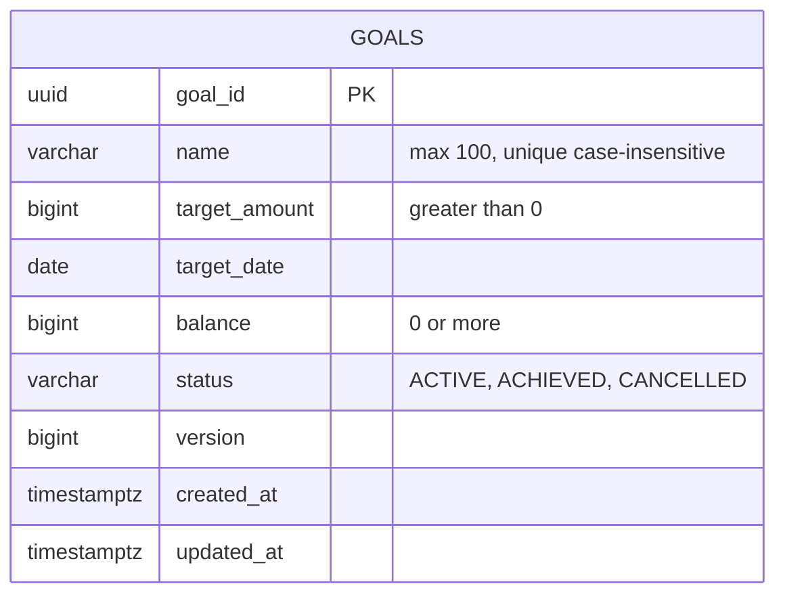
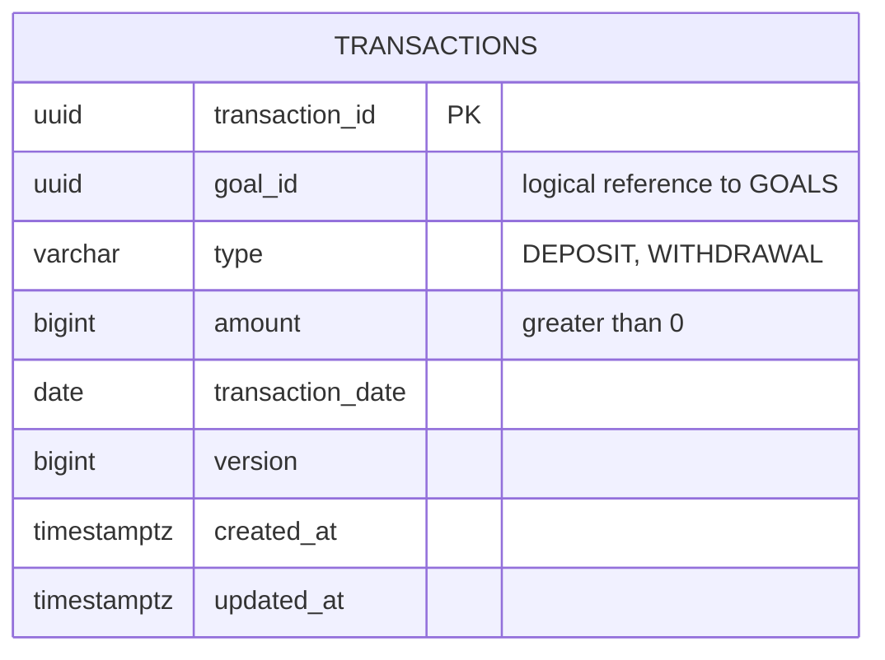
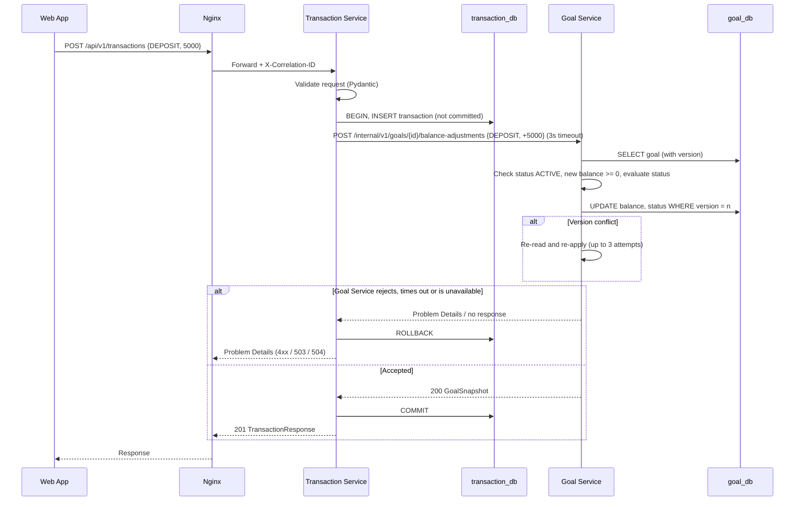
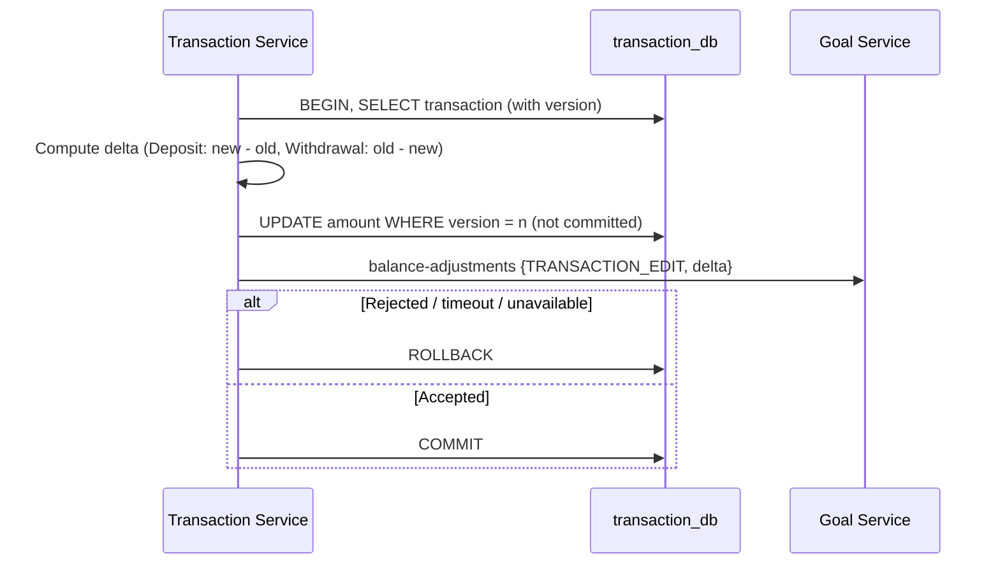
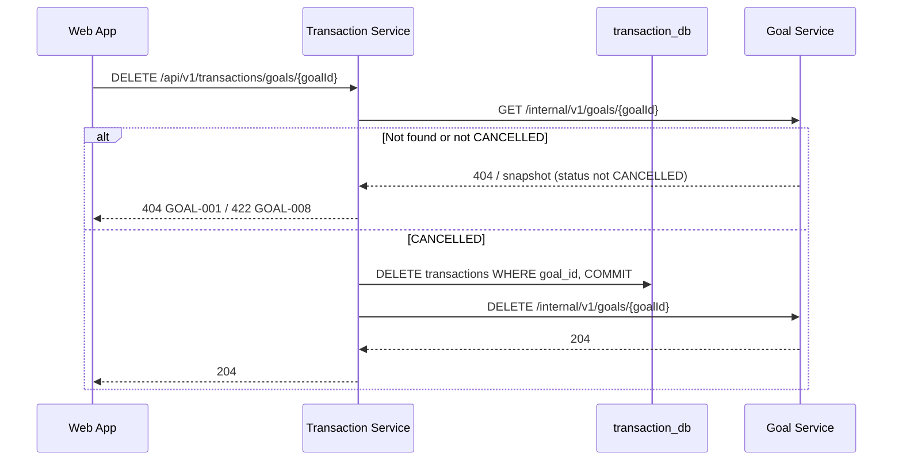

# Low Level Design Document
## Kalash – Savings Goal Planner (Release 1)

---

## 1. Document Control

| Item | Details |
|---|---|
| Document Title | Low Level Design – Kalash Savings Goal Planner |
| Product | Kalash |
| Release | Release 1 |
| Prepared By | Kalash Financial Services |
| Prepared For | Kalash Delivery Team (internal) |
| Version | 1.0 – Draft for Review |
| Date | 27 October 2026 |
| Status | Draft for Review |

### 1.1 Revision History

| Version | Date | Summary of Changes |
|---|---|---|
| 1.0 | 27 October 2026 | Initial draft |

---

## 2. Introduction

| Item | Details |
|---|---|
| Purpose | Give developers the detailed design they need to build Kalash Release 1 |
| Scope | Goal Service, Transaction Service, API Gateway, both databases, containers and pipelines |
| Out of Scope | Front-end component design; the Authentication and Profile Service (planned for a later version) |
| Audience | Developers, testers and DevOps engineers |

---

## 3. References

| Document | Version |
|---|---|
| Business Requirements Document (BRD) – Kalash Savings Goal Planner | 1.0 |
| High Level Design (HLD) – Kalash Savings Goal Planner | 1.1 |
| RFC 9457 – Problem Details for HTTP APIs | – |

---

## 4. Requirements Traceability

| User Story | Endpoint(s) | Service | Table(s) |
|---|---|---|---|
| KAL-BUC-00001 Create Goal | `POST /api/v1/goals` | Goal | goals |
| KAL-BUC-00002 Edit Goal | `PATCH /api/v1/goals/{goalId}` | Goal | goals |
| KAL-BUC-00003 Cancel Goal | `POST /api/v1/goals/{goalId}/cancel` | Goal | goals |
| KAL-BUC-00004 Delete Cancelled Goal | `DELETE /api/v1/transactions/goals/{goalId}` | Transaction → Goal | transactions, goals |
| KAL-BUC-00005 Record Deposit | `POST /api/v1/transactions` | Transaction → Goal | transactions, goals |
| KAL-BUC-00006 Record Withdrawal | `POST /api/v1/transactions` | Transaction → Goal | transactions, goals |
| KAL-BUC-00007 Edit Transaction | `PATCH /api/v1/transactions/{transactionId}` | Transaction → Goal | transactions, goals |
| KAL-BUC-00008 Delete Transaction | `DELETE /api/v1/transactions/{transactionId}` | Transaction → Goal | transactions, goals |
| KAL-BUC-00009 Transaction History | `GET /api/v1/transactions?goalId=` | Transaction → Goal | transactions |
| KAL-BUC-00010 to 00013 Progress, Monthly Saving, Off-track, Overdue | `GET /api/v1/goals/{goalId}` | Goal | goals |
| KAL-BUC-00014 Overview | `GET /api/v1/goals` | Goal | goals |
| KAL-BUC-00015, 00016 Status Changes | Internal balance adjustment, `PATCH /api/v1/goals/{goalId}` | Goal | goals |

---

## 5. Service Inventory

### 5.1 Services, Hosts and Ports

| Component | Container / Host Name | Container Port | Host Port | Exposed via Gateway |
|---|---|---|---|---|
| API Gateway + Web App | `gateway` | 80 | 80 | – |
| Goal Service | `goal-service` | 8080 | 8080 | `/api/v1/goals` |
| Transaction Service | `transaction-service` | 8000 | 8000 | `/api/v1/transactions` |
| Goal Database | `goal-db` | 5432 | 5432 | No |
| Transaction Database | `transaction-db` | 5432 | 5433 | No |

Service and database host ports are published for local development only.

### 5.2 Technology Versions

| Technology | Version | Note |
|---|---|---|
| Java | 25 (LTS) | |
| Spring Boot | 4.1.x | Current supported line |
| Python | 3.14.x | Python has no LTS; 3.14 chosen over 3.15 (released Oct 2026) for library maturity |
| FastAPI | 0.136.x | With Pydantic 2.x |
| SQLAlchemy / Alembic | 2.x / 1.x | psycopg 3 driver |
| PostgreSQL | 18.x | |
| React | 19.x | Built with Vite |
| Node.js (build only) | 24 (LTS) | |
| Nginx | 1.30.x (stable) | |
| Docker Compose | v2 | |

---

## 6. Environment and Configuration

**Environment:** local only (Docker Compose), with a single `.env` file. A `.env.example` is committed; `.env` is never committed.

| Variable | Used By | Example |
|---|---|---|
| `APP_TIMEZONE` | Goal, Transaction | `Asia/Kolkata` |
| `GOAL_DB_NAME` / `GOAL_DB_USER` / `GOAL_DB_PASSWORD` | Goal Service, goal-db | `goal_db` / `goal_user` / `***` |
| `TXN_DB_NAME` / `TXN_DB_USER` / `TXN_DB_PASSWORD` | Transaction Service, transaction-db | `transaction_db` / `txn_user` / `***` |
| `GOAL_SERVICE_BASE_URL` | Transaction Service | `http://goal-service:8080` |
| `GOAL_SERVICE_TIMEOUT_SECONDS` | Transaction Service | `3` |
| `LOG_LEVEL` | All services | `INFO` |
| `VITE_DEMO_USERNAME` / `VITE_DEMO_PASSWORD` | Web App (build time) | `demo` / `***` |

| Service | Configuration Mechanism |
|---|---|
| Goal Service | `application.yml`, with values from environment variables |
| Transaction Service | `pydantic-settings` (`Settings` class) |
| Web App | Vite `import.meta.env` at build time |

---

## 7. Code Structure and Modularity

**Approach:** feature-based folders. Each feature holds its own API, service, domain and repository layers. Shared concerns live in `common`.

### 7.1 Goal Service (`com.kalash.goal`)

```
goal-service/
├── src/main/java/com/kalash/goal/
│   ├── GoalServiceApplication.java
│   ├── goal/                 # Feature: goal management (public API)
│   │   ├── api/              # GoalController, request/response DTOs
│   │   ├── service/          # GoalService, GoalRules
│   │   ├── domain/           # Goal (entity), GoalStatus (enum)
│   │   └── repository/       # GoalRepository (Spring Data JPA)
│   ├── balance/              # Feature: balance adjustment (internal API)
│   │   ├── api/              # BalanceAdjustmentController, DTOs
│   │   └── service/          # BalanceAdjustmentService, StatusEvaluator
│   ├── insights/             # Feature: calculations
│   │   ├── InsightsCalculator.java
│   │   └── Insights.java
│   └── common/
│       ├── error/            # ErrorCode, ApiException, GlobalExceptionHandler
│       ├── config/           # Clock (Asia/Kolkata), Jackson, OpenAPI
│       └── logging/          # CorrelationIdFilter
├── src/main/resources/
│   ├── application.yml
│   └── db/migration/         # Flyway scripts
└── src/test/java/...
```

### 7.2 Transaction Service (`app`)

```
transaction-service/
├── app/
│   ├── main.py
│   ├── transactions/         # Feature: deposits, withdrawals, edits, history
│   │   ├── router.py         # FastAPI routes
│   │   ├── schemas.py        # Pydantic request/response models
│   │   ├── service.py        # Business flow and delta calculation
│   │   ├── models.py         # SQLAlchemy models
│   │   └── repository.py
│   ├── goal_deletion/        # Feature: delete cancelled goal (coordinator)
│   │   ├── router.py
│   │   └── service.py
│   ├── clients/
│   │   └── goal_client.py    # httpx client for the Goal Service internal API
│   └── common/               # config, db, errors, logging, clock
├── alembic/versions/         # Alembic migrations
└── tests/
```

### 7.3 Dependency Rules

| Rule |
|---|
| The Transaction Service may call the Goal Service. The Goal Service never calls the Transaction Service. |
| Features may use `common`; features do not import each other's repositories. |
| Controllers and routers contain no business logic. |

---

## 8. Coding Standards and Conventions

| Item | Convention |
|---|---|
| Java style | Standard Java conventions, enforced by Spotless in CI |
| Python style | PEP 8 with type hints, enforced by Ruff in CI |
| Database names | `snake_case`, plural table names |
| JSON fields | `camelCase` |
| Enum values | `UPPER_CASE` (e.g., `ACTIVE`, `DEPOSIT`) |
| URL paths | Lowercase, plural nouns, kebab-case for multi-word segments |
| Amounts | Whole rupees as integers (`long` / `int`); never floating point |
| Dates | `LocalDate` / `date` for business dates; `OffsetDateTime` / `datetime` (UTC) for timestamps |
| Time | Always read "today" from the injected clock (Asia/Kolkata); never from the system default |

---

## 9. Database Detailed Design

### 9.1 Goal Database (`goal_db`)

**Table: `goals`**

| Column | Type | Null | Default | Constraint / Note |
|---|---|---|---|---|
| `goal_id` | UUID | No | – | PK, generated by the service |
| `name` | VARCHAR(100) | No | – | Stored trimmed |
| `target_amount` | BIGINT | No | – | `CHECK (target_amount > 0)` |
| `target_date` | DATE | No | – | Future-date rule enforced in the service |
| `balance` | BIGINT | No | `0` | `CHECK (balance >= 0)` |
| `status` | VARCHAR(10) | No | `'ACTIVE'` | `CHECK (status IN ('ACTIVE','ACHIEVED','CANCELLED'))` |
| `version` | BIGINT | No | `0` | Optimistic lock |
| `created_at` | TIMESTAMPTZ | No | `now()` | UTC |
| `updated_at` | TIMESTAMPTZ | No | `now()` | UTC |

| Index | Columns | Purpose |
|---|---|---|
| `pk_goals` | `goal_id` | Primary key |
| `ux_goals_name_ci` | `lower(btrim(name))` (unique) | BR-03, case-insensitive and trimmed |
| `ix_goals_target_date` | `target_date, created_at` | Overview sort (BR-25) |

### 9.2 Transaction Database (`transaction_db`)

**Table: `transactions`**

| Column | Type | Null | Default | Constraint / Note |
|---|---|---|---|---|
| `transaction_id` | UUID | No | – | PK, generated by the service |
| `goal_id` | UUID | No | – | Logical reference to `goals.goal_id` (no FK across databases) |
| `type` | VARCHAR(10) | No | – | `CHECK (type IN ('DEPOSIT','WITHDRAWAL'))` |
| `amount` | BIGINT | No | – | `CHECK (amount > 0)` |
| `transaction_date` | DATE | No | – | IST date at creation; never changed (BR-09) |
| `version` | BIGINT | No | `0` | Optimistic lock |
| `created_at` | TIMESTAMPTZ | No | `now()` | UTC |
| `updated_at` | TIMESTAMPTZ | No | `now()` | UTC |

| Index | Columns | Purpose |
|---|---|---|
| `pk_transactions` | `transaction_id` | Primary key |
| `ix_transactions_goal_created` | `goal_id, created_at DESC` | History lookup and goal deletion |

### 9.3 Database Access

| Database | Owner User | Access |
|---|---|---|
| `goal_db` | `goal_user` | Goal Service only |
| `transaction_db` | `txn_user` | Transaction Service only |

---

## 10. Physical ER Diagrams

### 10.1 Goal Database



### 10.2 Transaction Database



---

## 11. Database Migration Strategy

| Item | Goal Service | Transaction Service |
|---|---|---|
| Tool | Flyway | Alembic |
| Location | `src/main/resources/db/migration` | `alembic/versions` |
| Naming | `V1__create_goals.sql`, `V2__...` | `0001_create_transactions.py`, `0002_...` |
| When Applied | Automatically on application start-up | `alembic upgrade head` in the container entrypoint, before start-up |

| Rule |
|---|
| Never edit a migration that has been applied; add a new one. |
| Every migration is tested in CI against PostgreSQL 18 (Testcontainers). |

---

## 12. API Conventions

| Item | Convention |
|---|---|
| Public base paths | `/api/v1/goals`, `/api/v1/transactions` |
| Internal base path | `/internal/v1/...`, for service-to-service calls only and never routed by the gateway |
| Format | JSON; errors use `application/problem+json` |
| IDs | UUID strings |
| Amounts | JSON integers (whole rupees); decimals are rejected |
| Dates | `YYYY-MM-DD` |
| Timestamps | ISO 8601 in UTC, e.g., `2026-10-27T06:30:00Z` |
| Pagination | `page` (0-based, default 0), `size` (default 20, max 100) |
| Correlation | `X-Correlation-ID` header on every request and response |
| API documentation | OpenAPI 3: Goal Service via springdoc at `/v3/api-docs` and `/swagger-ui`; Transaction Service at `/openapi.json` and `/docs` |

**Page response envelope**

```json
{
  "content": [],
  "page": 0,
  "size": 20,
  "totalElements": 0,
  "totalPages": 0
}
```

**HTTP status usage**

| Status | Use |
|---|---|
| 200 / 201 / 204 | Success / created (with `Location` header) / no content |
| 400 | Request format or field validation failed |
| 404 | Resource not found |
| 409 | Duplicate goal name or concurrent update conflict |
| 422 | Business rule violated |
| 500 | Unexpected error |
| 503 / 504 | Goal Service unavailable / timed out (Transaction Service only) |

---

## 13. API Contract Design

### 13.1 Goal Service – Public

| Method | Path | Purpose | Request | Success |
|---|---|---|---|---|
| POST | `/api/v1/goals` | Create a goal | `CreateGoalRequest` | 201 `GoalResponse` |
| GET | `/api/v1/goals?page=&size=` | Overview, sorted by target date ascending, then created date | – | 200 Page of `GoalResponse` |
| GET | `/api/v1/goals/{goalId}` | Goal details with insights | – | 200 `GoalResponse` |
| PATCH | `/api/v1/goals/{goalId}` | Edit name, target amount and/or target date | `UpdateGoalRequest` | 200 `GoalResponse` |
| POST | `/api/v1/goals/{goalId}/cancel` | Cancel a goal | – | 200 `GoalResponse` |

### 13.2 Transaction Service – Public

| Method | Path | Purpose | Request | Success |
|---|---|---|---|---|
| POST | `/api/v1/transactions` | Record a deposit or withdrawal | `CreateTransactionRequest` | 201 `TransactionResponse` |
| GET | `/api/v1/transactions?goalId=&page=&size=` | Transaction history, newest first | – | 200 Page of `TransactionResponse` |
| PATCH | `/api/v1/transactions/{transactionId}` | Edit the amount | `UpdateTransactionRequest` | 200 `TransactionResponse` |
| DELETE | `/api/v1/transactions/{transactionId}` | Delete a transaction | – | 204 |
| DELETE | `/api/v1/transactions/goals/{goalId}` | Delete a cancelled goal and its history | – | 204 |

### 13.3 Schemas

**CreateGoalRequest**

```json
{ "name": "Goa Trip", "targetAmount": 50000, "targetDate": "2027-03-31" }
```

**UpdateGoalRequest** (all fields optional; at least one is required)

```json
{ "name": "Goa Trip 2027", "targetAmount": 60000, "targetDate": "2027-06-30" }
```

**GoalResponse**

```json
{
  "goalId": "0b9e2f1c-6d3a-4c1e-9f2a-7a1d2b3c4d5e",
  "name": "Goa Trip",
  "targetAmount": 50000,
  "targetDate": "2027-03-31",
  "balance": 12000,
  "status": "ACTIVE",
  "insights": {
    "progressPercent": 24.0,
    "remainingAmount": 38000,
    "suggestedMonthlySaving": 7600,
    "offTrack": false,
    "overdue": false
  },
  "createdAt": "2026-10-27T06:30:00Z",
  "updatedAt": "2026-10-27T06:30:00Z"
}
```

`insights` is `null` for Cancelled goals.

**CreateTransactionRequest**

```json
{ "goalId": "0b9e2f1c-6d3a-4c1e-9f2a-7a1d2b3c4d5e", "type": "DEPOSIT", "amount": 5000 }
```

**UpdateTransactionRequest**

```json
{ "amount": 4500 }
```

**TransactionResponse**

```json
{
  "transactionId": "5c1d7e2a-0f3b-4a6c-8d9e-1a2b3c4d5e6f",
  "goalId": "0b9e2f1c-6d3a-4c1e-9f2a-7a1d2b3c4d5e",
  "type": "DEPOSIT",
  "amount": 5000,
  "transactionDate": "2026-10-27",
  "goalBalance": 17000,
  "goalStatus": "ACTIVE",
  "createdAt": "2026-10-27T06:35:00Z",
  "updatedAt": "2026-10-27T06:35:00Z"
}
```

`goalBalance` and `goalStatus` are returned on create, edit and delete responses only, so the web app can refresh without another call.

---

## 14. Inter-Service Communication Contracts

**Direction:** Transaction Service → Goal Service only. **Timeout:** 3 seconds. **Retries:** none.

| Method | Path (Goal Service) | Purpose | Request | Success |
|---|---|---|---|---|
| GET | `/internal/v1/goals/{goalId}` | Read goal status and balance | – | 200 `GoalSnapshot` |
| POST | `/internal/v1/goals/{goalId}/balance-adjustments` | Validate and apply a balance change | `BalanceAdjustmentRequest` | 200 `GoalSnapshot` |
| DELETE | `/internal/v1/goals/{goalId}` | Delete a Cancelled goal | – | 204 |

**BalanceAdjustmentRequest**

```json
{ "operation": "DEPOSIT", "delta": 5000 }
```

| `operation` | Allowed Goal Status | `delta` |
|---|---|---|
| `DEPOSIT` | ACTIVE | `+amount` |
| `WITHDRAWAL` | ACTIVE, ACHIEVED | `−amount` |
| `TRANSACTION_EDIT` | ACTIVE | Deposit: `new − old`; Withdrawal: `old − new` |
| `TRANSACTION_DELETE` | ACTIVE | Deposit: `−amount`; Withdrawal: `+amount` |

**GoalSnapshot**

```json
{ "goalId": "0b9e2f1c-...", "status": "ACTIVE", "balance": 17000, "targetAmount": 50000 }
```

| Failure | Transaction Service Behaviour |
|---|---|
| Goal Service returns a 4xx Problem Details response | Roll back the local change; pass the problem through unchanged |
| Timeout (over 3 seconds) | Roll back; return 504 `TXN-003` |
| Connection refused or 5xx | Roll back; return 503 `TXN-002` |

---

## 15. Business Rule Implementation Mapping

| Rule | Implemented In | Error Code |
|---|---|---|
| BR-01 Multiple goals | No restriction in `GoalService.create` | – |
| BR-02 Required fields | `CreateGoalRequest` validation | COMMON-400 |
| BR-03 Unique name | `GoalRules.ensureNameUnique` + `ux_goals_name_ci` | GOAL-002 |
| BR-04 Target amount | DTO validation (`@Positive`, integer) + DB check | COMMON-400 |
| BR-05 Future target date | `GoalRules.ensureFutureDate` | GOAL-003 |
| BR-06 Target greater than balance | `GoalRules.ensureTargetAboveBalance` | GOAL-004 |
| BR-07 Transaction amount | `CreateTransactionRequest` / `UpdateTransactionRequest` validation | COMMON-400 |
| BR-08 Records only | No external calls | – |
| BR-09 Auto date | `transactions.service` sets `transaction_date` from the IST clock | – |
| BR-10 Deposit on Active only | `BalanceAdjustmentService` operation check | GOAL-009 |
| BR-11 Overshoot accepted | No upper limit on deposits | – |
| BR-12 Withdrawal up to balance | `BalanceAdjustmentService` | GOAL-010, GOAL-012 |
| BR-13 Edit/delete on Active only | `BalanceAdjustmentService` operation check | GOAL-011 |
| BR-14 Balance never below ₹0 | `BalanceAdjustmentService` + DB check | GOAL-012 |
| BR-15 Auto-achieve | `StatusEvaluator.evaluate` | – |
| BR-16 Return to Active | `StatusEvaluator.evaluate`, `GoalService.update` | – |
| BR-17 Achieved: withdraw or raise target only | `GoalRules.ensureEditAllowed` + operation check | GOAL-005 |
| BR-18 Cancel rules | `GoalService.cancel` | GOAL-006, GOAL-007 |
| BR-19 Cancelled is read-only | `GoalRules.ensureEditAllowed` + operation check | GOAL-005 |
| BR-20 Delete Cancelled only | `goal_deletion.service` + internal DELETE | GOAL-008 |
| BR-21 Overdue | `InsightsCalculator` | – |
| BR-22 to BR-24 Progress, monthly, off-track | `InsightsCalculator` | – |
| BR-25 Overview sort | `GoalRepository` (`ORDER BY target_date, created_at`) | – |

**StatusEvaluator** (runs after every balance or target change)

| Current Status | Condition | New Status |
|---|---|---|
| ACTIVE | `balance >= targetAmount` | ACHIEVED |
| ACHIEVED | `balance < targetAmount` | ACTIVE |

---

## 16. Calculation Logic

**Owner:** Goal Service, `insights.InsightsCalculator`. **When:** on every read; nothing is stored. **Design:** a pure function with an injected `Clock` (Asia/Kolkata).

### 16.1 Inputs

| Input | Source | Type |
|---|---|---|
| `balance` | goals.balance | long |
| `target` | goals.target_amount | long |
| `targetDate` | goals.target_date | LocalDate |
| `createdDate` | goals.created_at converted to an IST date | LocalDate |
| `status` | goals.status | GoalStatus |
| `today` | Clock (Asia/Kolkata) | LocalDate |

### 16.2 Formulas

| Output | Rule | Formula |
|---|---|---|
| Progress % | BR-22 | `balance ÷ target × 100`, 1 decimal place, rounded down (`RoundingMode.DOWN`), not capped |
| Remaining | BR-22 | `max(target − balance, 0)` |
| Overdue | BR-21 | `status = ACTIVE` and `today > targetDate` and `balance < target` |
| Months left | BR-23 | Complete calendar months from `today` to `targetDate` (`Period.between(...).toTotalMonths()`) |
| Suggested monthly | BR-23 | `remaining = 0` → 0; `overdue` or `monthsLeft < 1` → `remaining`; otherwise `ceil(remaining ÷ monthsLeft)` |
| Elapsed % | BR-24 | `min(days(createdDate→today) ÷ days(createdDate→targetDate), 1) × 100` |
| Off-track | BR-24 | `status = ACTIVE` and `progress% < elapsed%`, compared using unrounded values |
| Cancelled | – | `insights = null` |

### 16.3 Pseudocode

```
if status == CANCELLED: return null
remaining   = max(target - balance, 0)
progressRaw = balance * 100.0 / target
progressPct = floorTo1Decimal(progressRaw)
overdue     = status == ACTIVE && today > targetDate && balance < target
monthsLeft  = completeMonthsBetween(today, targetDate)
monthly     = remaining == 0 ? 0
            : (overdue || monthsLeft < 1) ? remaining
            : ceilDiv(remaining, monthsLeft)
elapsedPct  = min(days(createdDate, today) / days(createdDate, targetDate), 1) * 100
offTrack    = status == ACTIVE && progressRaw < elapsedPct
```

### 16.4 Worked Examples (Unit Test Cases)

| # | Balance | Target | Created | Target Date | Today | Progress | Remaining | Monthly | Off-track | Overdue |
|---|---|---|---|---|---|---|---|---|---|---|
| 1 | 0 | 10,000 | 01-Nov-26 | 01-Feb-27 | 01-Nov-26 | 0.0% | 10,000 | 3,334 | No | No |
| 2 | 3,000 | 10,000 | 01-Nov-26 | 01-Mar-27 | 01-Jan-27 | 30.0% | 7,000 | 3,500 | Yes | No |
| 3 | 6,000 | 10,000 | 01-Nov-26 | 01-Mar-27 | 01-Jan-27 | 60.0% | 4,000 | 2,000 | No | No |
| 4 | 8,000 | 10,000 | 01-Nov-26 | 20-Dec-26 | 05-Dec-26 | 80.0% | 2,000 | 2,000 | No | No |
| 5 | 5,000 | 10,000 | 01-Nov-26 | 01-Dec-26 | 10-Dec-26 | 50.0% | 5,000 | 5,000 | Yes | Yes |
| 6 | 12,000 | 10,000 | 01-Nov-26 | 01-Mar-27 | 01-Jan-27 | 120.0% | 0 | 0 | No (Achieved) | No |
| 7 | 9,996 | 10,000 | 01-Nov-26 | 01-Mar-27 | 01-Jan-27 | 99.9% | 4 | 2 | No | No |

### 16.5 Edge Rules

| Case | Handling |
|---|---|
| Today equals the target date | Not overdue; `monthsLeft = 0`, so monthly = remaining |
| Creation day | Elapsed is 0%, so never off-track |
| Target date edited | Elapsed uses the new target date; the created date is unchanged |
| Achieved goal | Remaining 0, monthly 0, no indicators |

---

## 17. Detailed Sequence Diagrams

### 17.1 Record a Deposit (with local transaction, timeout and optimistic lock)



### 17.2 Edit a Transaction



### 17.3 Delete a Cancelled Goal



---

## 18. API Gateway Configuration

```nginx
upstream goal_service        { server goal-service:8080; }
upstream transaction_service { server transaction-service:8000; }

map $http_x_correlation_id $correlation_id {
    default $http_x_correlation_id;
    ""      $request_id;
}

server {
    listen 80;
    root /usr/share/nginx/html;

    location / { try_files $uri /index.html; }               # React web app

    location /api/v1/goals {
        proxy_pass http://goal_service;
        proxy_set_header X-Correlation-ID $correlation_id;
        proxy_read_timeout 10s;
    }

    location /api/v1/transactions {
        proxy_pass http://transaction_service;
        proxy_set_header X-Correlation-ID $correlation_id;
        proxy_read_timeout 10s;
    }

    location /internal/ { return 404; }                       # Never exposed

    add_header X-Correlation-ID $correlation_id always;
}
```

Access logs are written in JSON format, including `$correlation_id`.

---

## 19. Security Design

| Area | Release 1 Design |
|---|---|
| Demo login | The web app compares input with `VITE_DEMO_USERNAME` / `VITE_DEMO_PASSWORD`. On success, it sets a session flag in `sessionStorage`; a route guard protects all pages; logout clears the flag. |
| Limitation | The credentials are embedded in the JavaScript bundle. This is for demonstration only and is not a security control. |
| Back-end access | No authentication or authorisation in Release 1 |
| Internal APIs | `/internal/*` is blocked at the gateway |
| CORS | Not enabled; the web app and APIs share one origin through Nginx |
| Secrets | Database passwords only in `.env`; never in code or logs |
| Database | One database user per service, with rights on its own database only |
| Injection | Parameterised queries only (JPA / SQLAlchemy); validated input |

---

## 20. External Integrations

None in Release 1.

---

## 21. Error Handling Design

### 21.1 Response Format (RFC 9457)

```json
{
  "type": "urn:kalash:error:GOAL-002",
  "title": "Goal name already in use",
  "status": 409,
  "detail": "A goal named 'Goa Trip' already exists.",
  "instance": "/api/v1/goals",
  "errorCode": "GOAL-002",
  "correlationId": "7f3c2a9e-1b4d-4e8f-a2c6-9d0e1f2a3b4c",
  "timestamp": "2026-10-27T06:40:00Z",
  "errors": [
    { "field": "name", "message": "Name is already in use" }
  ]
}
```

`errors` is included for validation failures only.

| Service | Implementation |
|---|---|
| Goal Service | Spring `ProblemDetail` + `@RestControllerAdvice` (`GlobalExceptionHandler`) |
| Transaction Service | FastAPI exception handlers returning `application/problem+json` |

### 21.2 Error Code Catalogue

| Code | HTTP | Title | Rule |
|---|---|---|---|
| COMMON-400 | 400 | Validation failed | BR-02, BR-04, BR-07 |
| COMMON-409 | 409 | Concurrent update conflict, please retry | – |
| COMMON-500 | 500 | Unexpected error | – |
| GOAL-001 | 404 | Goal not found | – |
| GOAL-002 | 409 | Goal name already in use | BR-03 |
| GOAL-003 | 422 | Target date must be a future date | BR-05 |
| GOAL-004 | 422 | Target amount must be greater than the current balance | BR-06 |
| GOAL-005 | 422 | This change is not permitted for the goal's status | BR-17, BR-19 |
| GOAL-006 | 422 | Only Active goals can be cancelled | BR-18 |
| GOAL-007 | 422 | Withdraw the full balance before cancelling | BR-18 |
| GOAL-008 | 422 | Only Cancelled goals can be deleted | BR-20 |
| GOAL-009 | 422 | Deposits can be recorded only on Active goals | BR-10 |
| GOAL-010 | 422 | Withdrawals are not permitted on Cancelled goals | BR-12 |
| GOAL-011 | 422 | Transactions can be changed only on Active goals | BR-13 |
| GOAL-012 | 422 | The balance cannot go below ₹0 | BR-12, BR-14 |
| TXN-001 | 404 | Transaction not found | – |
| TXN-002 | 503 | Goal Service unavailable, please try again | – |
| TXN-003 | 504 | Goal Service did not respond in time, please try again | – |

Goal Service errors are passed through the Transaction Service unchanged.

---

## 22. Validation Design

| Layer | Checks | Result |
|---|---|---|
| Web app | Same field rules, for guidance only | Inline messages |
| DTO / schema | Presence, type, format, range | 400 COMMON-400 |
| Service | Business rules (date, status, balance, uniqueness) | 409 / 422 |
| Database | CHECK, UNIQUE, NOT NULL constraints (last line of defence) | Mapped to the matching code |

| Field | Rule | Goal Service | Transaction Service |
|---|---|---|---|
| `name` | Required, trimmed, 1–100 characters | `@NotBlank @Size(max=100)` | – |
| `targetAmount` | Required on create, integer ≥ 1 | `@NotNull @Positive Long`; float-to-int coercion disabled | – |
| `targetDate` | Required on create, ISO date, after today (IST) | `@NotNull LocalDate` + `GoalRules` | – |
| `goalId` | Required, UUID | `UUID` path variable | `UUID` |
| `type` | `DEPOSIT` or `WITHDRAWAL` | – | `Literal` / Enum |
| `amount` | Required, integer ≥ 1 | – | `StrictInt`, `gt=0` |
| `page` / `size` | `page ≥ 0`; `1 ≤ size ≤ 100` | `@Min @Max` | `Query(ge, le)` |
| PATCH body | At least one field present | Custom validator | – |

---

## 23. Concurrency and Data Consistency

| Concern | Design |
|---|---|
| Concurrent goal updates | JPA `@Version` on `goals`. The Goal Service retries the read-modify-write up to 3 times in the same request, then returns 409 COMMON-409. |
| Concurrent transaction edits | SQLAlchemy `version_id_col` on `transactions`; a conflict returns 409 COMMON-409 |
| Balance ownership | Only the Goal Service writes `balance` and `status` |
| Cross-service changes | Transaction Service: local change (not committed) → Goal Service call → commit, or roll back on any failure |
| Inter-service retries | None (3-second timeout) |

| Failure Point | Outcome |
|---|---|
| Goal Service rejects, times out or is unavailable | Local change rolled back; data stays consistent |
| Goal Service committed, then the Transaction Service commit fails | Data mismatch. Logged at ERROR with correlationId, goalId and delta for manual correction (see Open Issues). |
| Goal deletion fails after history is removed | Goal remains Cancelled with ₹0 and no history; the delete can be safely retried |

---

## 24. NFR Implementation

| NFR | Implementation |
|---|---|
| Usability | Human-readable `title` / `detail` in every error; the web app displays them as they are |
| Performance | Indexes (Section 9); paginated lists; insights computed in memory; default connection pools (HikariCP, SQLAlchemy) |
| Data accuracy | BIGINT whole rupees; a single writer of the balance; optimistic locking; DB CHECK constraints; unit tests on every calculation |
| Data privacy | No external calls; databases reachable only from their own service; no credentials or secrets in logs |
| Scalability | Stateless services; can be scaled with `docker compose up --scale` behind Nginx upstreams |
| Availability | `restart: unless-stopped`; Docker health checks; `depends_on: condition: service_healthy`; persistent volumes |

---

## 25. Logging Design

| Item | Design |
|---|---|
| Format | Structured JSON to stdout |
| Goal Service | Spring Boot structured logging (ECS format) |
| Transaction Service | Python `logging` with a JSON formatter |
| Nginx | JSON access log |
| Correlation | Nginx sets `X-Correlation-ID` (or reuses an incoming one). Spring stores it in MDC via `CorrelationIdFilter`; FastAPI middleware stores it in a `contextvar`; the httpx client forwards it to the Goal Service. |

| Field | Description |
|---|---|
| `timestamp` | UTC, ISO 8601 |
| `level` | DEBUG / INFO / WARN / ERROR |
| `service` | `goal-service` / `transaction-service` |
| `correlationId` | From `X-Correlation-ID` |
| `message` | Event description |
| `goalId`, `transactionId`, `operation`, `durationMs` | When relevant |

| Level | Use |
|---|---|
| INFO | Request completed; goal or transaction created, changed or deleted |
| WARN | Business rule rejection (4xx); optimistic lock retry |
| ERROR | 5xx; Goal Service timeout or unavailability; cross-service mismatch |

---

## 26. Monitoring, Health Checks and Observability

| Service | Health | Metrics |
|---|---|---|
| Goal Service | `/actuator/health` (includes DB) | `/actuator/prometheus` (Micrometer) |
| Transaction Service | `/health` (includes a DB check) | `/metrics` (`prometheus-fastapi-instrumentator`) |
| Nginx | Container health check on `/` | – |
| PostgreSQL | `pg_isready` | – |

| Key Metrics |
|---|
| Request count and latency by endpoint and status |
| Goal Service call latency and failures (from the Transaction Service) |
| Database connection pool usage |
| Optimistic lock retries |

Metrics endpoints are not routed by the gateway. No dashboards or alerting in Release 1.

---

## 27. Containerisation and Deployment Details

| Image | Build | Base (Runtime) |
|---|---|---|
| `kalash/goal-service` | Multi-stage, built with Maven | `eclipse-temurin:25-jre` |
| `kalash/transaction-service` | `pip install -r requirements.txt` | `python:3.14-slim` (Uvicorn) |
| `kalash/gateway` | Stage 1 `node:24` builds React (`npm ci && npm run build`); stage 2 copies `dist/` | `nginx:1.30-alpine` |
| Databases | Official image | `postgres:18` |

**docker-compose.yml (outline)**

```yaml
services:
  gateway:
    image: kalash/gateway
    ports: ["80:80"]
    depends_on:
      goal-service: { condition: service_healthy }
      transaction-service: { condition: service_healthy }
  goal-service:
    image: kalash/goal-service
    ports: ["8080:8080"]
    env_file: .env
    depends_on: { goal-db: { condition: service_healthy } }
  transaction-service:
    image: kalash/transaction-service
    ports: ["8000:8000"]
    env_file: .env
    depends_on:
      transaction-db: { condition: service_healthy }
      goal-service: { condition: service_healthy }
  goal-db:
    image: postgres:18
    ports: ["5432:5432"]
    volumes: ["goal-data:/var/lib/postgresql"]
  transaction-db:
    image: postgres:18
    ports: ["5433:5432"]
    volumes: ["transaction-data:/var/lib/postgresql"]
volumes:
  goal-data:
  transaction-data:
```

Every service also has `restart: unless-stopped` and a `healthcheck` (Section 26).

---

## 28. CI/CD Pipeline Details

| Workflow | Trigger | Steps |
|---|---|---|
| `goal-service.yml` | Push / PR touching `goal-service/**` | Spotless check → Maven build → Unit + integration tests → Docker build → Push image |
| `transaction-service.yml` | Push / PR touching `transaction-service/**` | Ruff → pytest (unit + integration) → Docker build → Push image |
| `gateway.yml` | Push / PR touching `web-app/**` or `gateway/**` | `npm ci` → Lint → Build → Docker build → Push image |

| Item | Design |
|---|---|
| Image tags | `<semver>` and `<git-sha>` |
| Push | On the `main` branch and release tags only |
| Deploy | `docker compose pull && docker compose up -d` on the target host |
| Registry | To be confirmed (HLD Open Issue) |

---

## 29. Backup Implementation

| Item | Design |
|---|---|
| Schedule | Daily at 02:00 IST (host cron) |
| Command | `docker compose exec -T goal-db pg_dump -U goal_user -Fc goal_db` (same for `transaction-db`) |
| Location | `/backups/<db>/<YYYY-MM-DD>.dump`, outside the data volumes |
| Retention | 7 days |
| Restore | `pg_restore --clean --if-exists -d <db> <file>` |

---

## 30. Testing Approach

| Level | Goal Service | Transaction Service | Focus |
|---|---|---|---|
| Unit | JUnit 5 + Mockito | pytest | `InsightsCalculator` (Section 16.4 cases), `StatusEvaluator`, rules, delta calculation |
| Integration | Spring Boot Test + Testcontainers (PostgreSQL 18) | pytest + Testcontainers + mocked Goal Service (`respx`) | Repositories, migrations, constraints, optimistic locking, rollback paths |
| API | MockMvc | FastAPI `TestClient` | Status codes, Problem Details, validation |

| Rule |
|---|
| Time-dependent tests use a fixed clock. |
| Every error code in Section 21.2 has at least one test. |
| All tests run in CI on every pull request. |

---

## 31. Open Issues

| # | Item | Proposed / Status |
|---|---|---|
| 1 | Hosting for the Docker deployment | To be confirmed (from HLD) |
| 2 | Container registry | To be confirmed (from HLD) |
| 3 | Goal name maximum length | Proposed: 100 characters |
| 4 | Transaction history order | Proposed: newest first |
| 5 | Default and maximum page size | Proposed: 20 and 100 |
| 6 | Build and tooling choices | Proposed: Maven, Vite, Spotless, Ruff, pip with `requirements.txt` |
| 7 | Backup retention | Proposed: 7 days |
| 8 | Recovery from a cross-service commit mismatch | Manual correction in Release 1; an automated reconciliation job is to be decided |
| 9 | Test framework version | Spring Boot 4.1 manages the JUnit 6 line, which keeps the JUnit 5 (Jupiter) API; confirm the version to pin |

---

## 32. Glossary

| Term | Meaning |
|---|---|
| Correlation ID | A unique ID that follows one request across all services and logs |
| Delta | A signed change to a goal's balance |
| DTO | Data Transfer Object: the request or response shape of an API |
| Flyway / Alembic | Database migration tools for Java and Python |
| Optimistic Locking | Detecting conflicting updates with a version number instead of locks |
| Problem Details | The standard error response format defined in RFC 9457 |
| Testcontainers | A library that starts real databases in containers for tests |
| Upstream | A back-end server group that Nginx forwards requests to |
| UUID | A globally unique identifier |

---

## 33. Review and Approval

| Role | Name | Signature | Date |
|---|---|---|---|
| Technical Lead | | | |
| Development Team Representative | | | |
| QA Representative | | | |

---

*End of Document*
